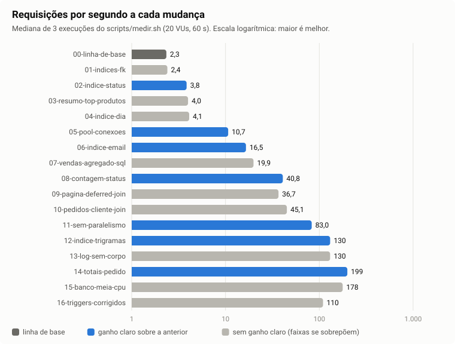
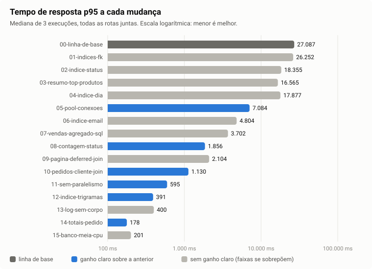

# A API não precisava de mais máquina: precisava que o banco parasse de refazer trabalho (85× mais requisições por segundo, mesmas respostas)

## 1. Resumo

A API de uma loja (Node.js + PostgreSQL) atendia 2,34 requisições por segundo, com p95 de 27 s sob 20 usuários simultâneos, e o banco ficava saturado. O diagnóstico encontrou varreduras de tabela inteira por falta de índice, uma conexão por consulta, N+1, consulta paralela num banco de 1 CPU e relatórios recalculados a cada chamada. Quatorze mudanças, medidas uma a uma, levaram a 199 req/s e p95 de 178 ms, com os mesmos recursos e as mesmas respostas (conferidas em 790 URLs). Com metade da CPU no banco, 178 req/s.

## 2. Contexto e diagnóstico

A carga sorteia sete rotas de leitura (clientes, pedidos, busca de produtos, relatórios). Na linha de base, o banco usava em média 95% de 1 CPU e a API, 10% (seu limite é 50%): o tempo ia para o banco ([medições](../resultados/20261107-015412-00-linha-de-base/resumo.txt), [medianas](../analise/medianas.md)).

Para saber onde, escrevi um coletor (`diagnostico/coletar.sh`): plano de execução de cada consulta, consultas e conexões por chamada e, sob a mesma carga, as consultas que mais ocupam o banco (`pg_stat_statements`, ligado só no diagnóstico, e amostras de `pg_stat_activity`). Na linha de base ([diagnostico/00-linha-de-base](../diagnostico/00-linha-de-base/)):

- só existiam os índices das chaves primárias; itens por pedido tomava 40,5% do tempo do banco e leu 228 milhões de linhas em 60 s de carga;
- uma chamada de "pedidos do cliente" fazia 17 consultas e abria 17 conexões;
- conexão nova custava ~6× uma reaproveitada (`custo-conexao.txt`);
- havia em média 14 sessões ativas para 1 CPU;
- cada requisição gerava ~1,1 KB de log, com nome e e-mail de clientes.

Hipóteses de causa, uma por problema:

- falta de índice nas chaves estrangeiras e nas expressões filtradas, o que força varreduras completas;
- conexão nova por consulta, que cria um processo no banco a cada consulta;
- N+1, ou seja, uma ida ao banco por pedido e por item;
- contagens e relatórios recalculados sobre 1,5 milhão de itens a cada chamada;
- consulta paralela num container de 1 CPU, que só acrescenta coordenação;
- log com o corpo da resposta, que gasta CPU e grava dados pessoais.

## 3. Estado da arte

### Índices certos para cada consulta

Declarar uma chave estrangeira não cria índice na coluna que referencia [1]. Uma consulta com `lower(email) = ...` pode usar um índice criado sobre o resultado de `lower()`, que em troca custa mais para manter na escrita [2]. Um B-tree pode entregar linhas já na ordem do `ORDER BY` [3] e responder só com o índice quando o *visibility map* está em dia [4]. O `pg_trgm` indexa trigramas e atende `ILIKE '%termo%'` [5]. Num estudo de aplicações reais, índice ausente foi o problema de desempenho mais relatado nos bug trackers [6].

### Menos idas ao banco

Conectar um cliente novo exige um *handshake* que pode levar 20–30 ms [7], e o PostgreSQL cria um processo por conexão [8]. Poolers externos ajudam, mas em modo *transaction* impedem recursos como *prepared statements* [9][10]. Chen et al. descrevem o processamento "um a um" em laço (o N+1) como anti-padrão que se resolve com consultas em lote, e relatam que corrigir os anti-padrões detectados melhorou o tempo de resposta em até 98% [11]; o N+1 continua comum em aplicações reais [6].

### Pré-calcular o que é muito lido e pouco escrito

Por causa do MVCC, `count(*)` precisa visitar as linhas para saber quais são visíveis [12]. *Triggers* podem manter uma tabela de resumo que substitui a original em certas consultas, "often with vastly reduced run times" [13], mas o custo vai para a escrita: num teste, inserções com trigger de contagem ficaram 50× mais lentas [14]. Uma *materialized view* lê rápido, mas fica desatualizada até o próximo refresh [15]. Um cache não garante consistência com o banco [16]. Para paginação por `OFFSET`, buscar primeiro só os ids da página e depois as linhas reduz o trabalho [17][18]; já a paginação por *keyset* não permite saltar para uma página arbitrária [19].

### Medir com honestidade

Gerador de carga em modelo fechado (usuários fixos, como aqui) pode subestimar muito o tempo de resposta de um sistema aberto [20][21]. Três repetições não bastam para um intervalo de confiança: num estudo de redes de nuvem, a mediana de 3 execuções caiu fora do intervalo de referência em 6 de 8 distribuições [22].

## 4. Alternativas consideradas

| Alternativa | Custo | Desempenho | Risco | Esforço |
|---|---|---|---|---|
| Índices (FK, expressão, composto, trigramas) | Disco e escrita: o banco passou de 294 para ~410 MB, junto com os resumos | Alto nas rotas filtradas | Baixo: o SQL não muda | Baixo |
| Pool de conexões na API (`pg.Pool`) | Nenhum | Alto | Baixo | Baixo |
| PgBouncer como serviço novo | Mais um container | Parecido com o pool para 1 instância da API | Médio: modo *transaction* quebra recursos [9] | Médio |
| Resumos mantidos por trigger | Escrita mais lenta [14]; linhas disputadas | Leitura de poucas linhas | Médio: erro em trigger corrompe o resumo | Alto |
| Materialized view + refresh periódico | Refresh recalcula tudo | Leitura de poucas linhas | Dados desatualizados [15]: muda o que a API devolve se houver escrita | Médio |
| Cache na API | Memória; invalidação | Alto só se as chaves se repetem | Inconsistência [16] | Baixo |
| Mais CPU e memória | Cresce linearmente com o recurso | Limitado: o banco faria o mesmo trabalho inútil mais rápido | Baixo | Baixo |
| Paginação por *keyset* | Nenhum | Alto | Quebra o contrato (`pagina`) [19] | Médio |

Fiquei com as alternativas de baixo risco e baixo esforço que atacam a causa (índices, pool, consultas reescritas). O esforço maior dos resumos só foi aceito onde a consulta não tinha como ficar barata, porque soma tudo a cada chamada. Ficaram de fora as opções que mudam o contrato (keyset) e as que mudam o que a API devolve depois de uma escrita (materialized view, cache). O cache tem ainda um problema específico deste teste: a carga sorteia só 12 termos de busca e 1 URL de top-produtos, então a taxa de acerto seria artificialmente alta e o ganho não representaria uso real. Recurso extra também ficou de fora: o diagnóstico mostrava trabalho desnecessário, não falta de máquina.

## 5. Solução escolhida e por quê

Tirei o trabalho desnecessário de onde ele acontecia, uma mudança por vez, na ordem que o diagnóstico apontava, sem serviço novo nem recurso extra. Mais CPU, na minha avaliação, só faria o banco refazer o mesmo trabalho mais depressa, e a fatura cresceria junto.

Para contagens e relatórios, escolhi resumos mantidos por trigger, e não materialized view ou cache. A pergunta-guia pede "sem mudar o que ela faz", e o trigger roda na mesma transação da escrita, então o resumo nunca fica atrasado. Vendas-por-dia guarda totais **por pedido**, não por dia. Um resumo diário faria todas as inserções do dia disputarem a mesma linha e serializaria o checkout; com uma linha por pedido, duas escritas só disputam a mesma linha se mexerem no mesmo pedido.

Ficou de fora o PgBouncer: com uma instância da API, o pool interno resolve o mesmo problema sem mais um serviço. Também não testei cluster de processos Node, porque com 0,5 CPU não haveria núcleo livre para usar.

## 6. Experimento e resultado

"Antes" é a mudança anterior. Cada célula é a mediana de 3 execuções do `scripts/medir.sh`. "Sem ganho claro" quer dizer que as faixas das 3 execuções se sobrepõem (detalhes e fontes de cada ideia em [experimentos.md](../experimentos.md)).

<!-- tabela-artigo:inicio -->
| Mudança | Hipótese | p95 antes → depois | req/s antes → depois | CPU média banco · API | Pastas de resultados | Conclusão |
|---|---|---|---|---|---|---|
| 01-indices-fk | Varredura total nas FKs vira busca por índice | 27.087 → 26.252 ms | 2,34 → 2,40 | 95→104% · 10→14% | [1](../resultados/20261107-020845-01-indices-fk/resumo.txt) [2](../resultados/20261107-021059-01-indices-fk/resumo.txt) [3](../resultados/20261107-021309-01-indices-fk/resumo.txt) | **Sem ganho claro.** Resolveu a consulta-alvo, mas o banco seguiu saturado pelas outras |
| 02-indice-status | Índice na ordem do ORDER BY da paginação | 26.252 → 18.355 ms | 2,40 → 3,85 | 104→102% · 14→19% | [1](../resultados/20261107-025201-02-indice-status/resumo.txt) [2](../resultados/20261107-025411-02-indice-status/resumo.txt) [3](../resultados/20261107-025629-02-indice-status/resumo.txt) | Ganho na rota e no geral; count passou a usar só o índice |
| 03-resumo-top-produtos | Resumo por produto mantido por trigger (exato) | 18.355 → 16.565 ms | 3,85 → 3,99 | 102→107% · 19→22% | [1](../resultados/20261107-024245-03-resumo-top-produtos/resumo.txt) [2](../resultados/20261107-024438-03-resumo-top-produtos/resumo.txt) [3](../resultados/20261107-024630-03-resumo-top-produtos/resumo.txt) | **Sem ganho claro.** Rota 20× mais rápida; peso pequeno na carga (2%) |
| 04-indice-dia | Índice na expressão do filtro de data | 16.565 → 17.877 ms | 3,99 → 4,10 | 107→110% · 22→23% | [1](../resultados/20261107-030242-04-indice-dia/resumo.txt) [2](../resultados/20261107-030438-04-indice-dia/resumo.txt) [3](../resultados/20261107-030630-04-indice-dia/resumo.txt) | **Sem ganho claro.** Plano certo, efeito geral escondido pelo ruído |
| 05-pool-conexoes | Reaproveitar conexões (pool) | 17.877 → 7.084 ms | 4,10 → 10,68 | 110→101% · 23→37% | [1](../resultados/20261107-082338-05-pool-conexoes/resumo.txt) [2](../resultados/20261107-082533-05-pool-conexoes/resumo.txt) [3](../resultados/20261107-082725-05-pool-conexoes/resumo.txt) | Maior salto até aqui; 17 → 0 conexões novas por requisição |
| 06-indice-email | Índice em lower(email), SQL intacto | 7.084 → 4.804 ms | 10,68 → 16,52 | 101→87% · 37→43% | [1](../resultados/20261107-083735-06-indice-email/resumo.txt) [2](../resultados/20261107-083927-06-indice-email/resumo.txt) [3](../resultados/20261107-084117-06-indice-email/resumo.txt) | Ganho claro; API começa a encostar no limite |
| 07-vendas-agregado-sql | Agregar no banco em vez de no Node | 4.804 → 3.702 ms | 16,52 → 19,89 | 87→103% · 43→16% | [1](../resultados/20261107-084436-07-vendas-agregado-sql/resumo.txt) [2](../resultados/20261107-084633-07-vendas-agregado-sql/resumo.txt) [3](../resultados/20261107-084825-07-vendas-agregado-sql/resumo.txt) | **Sem ganho claro.** CPU da API por requisição 3,4× menor; banco segue o gargalo |
| 08-contagem-status | Contagem exata mantida por trigger | 3.702 → 1.856 ms | 19,89 → 40,84 | 103→101% · 16→24% | [1](../resultados/20261107-085516-08-contagem-status/resumo.txt) [2](../resultados/20261107-085655-08-contagem-status/resumo.txt) [3](../resultados/20261107-085835-08-contagem-status/resumo.txt) | Dobrou o req/s; custo vai para a escrita |
| 09-pagina-deferred-join | Ids da página só pelo índice | 1.856 → 2.104 ms | 40,84 → 36,73 | 101→104% · 24→24% | [1](../resultados/20261107-092522-09-pagina-deferred-join/resumo.txt) [2](../resultados/20261107-092705-09-pagina-deferred-join/resumo.txt) [3](../resultados/20261107-092849-09-pagina-deferred-join/resumo.txt) | **Sem ganho claro.** Rota 2,9× melhor; geral dentro do ruído |
| 10-pedidos-cliente-join | N+1 → uma consulta | 2.104 → 1.130 ms | 36,73 → 45,10 | 104→104% · 24→16% | [1](../resultados/20261107-094122-10-pedidos-cliente-join/resumo.txt) [2](../resultados/20261107-094303-10-pedidos-cliente-join/resumo.txt) [3](../resultados/20261107-094444-10-pedidos-cliente-join/resumo.txt) | p95 geral quase pela metade |
| 11-sem-paralelismo | Sem consulta paralela num banco de 1 CPU | 1.130 → 595 ms | 45,10 → 82,98 | 104→104% · 16→23% | [1](../resultados/20261107-095534-11-sem-paralelismo/resumo.txt) [2](../resultados/20261107-095715-11-sem-paralelismo/resumo.txt) [3](../resultados/20261107-095855-11-sem-paralelismo/resumo.txt) | Uma linha de configuração, ganho de ~1,8× |
| 12-indice-trigramas | Trigramas para ILIKE com curinga | 595 → 391 ms | 82,98 → 130,47 | 104→103% · 23→38% | [1](../resultados/20261107-100352-12-indice-trigramas/resumo.txt) [2](../resultados/20261107-100528-12-indice-trigramas/resumo.txt) [3](../resultados/20261107-100705-12-indice-trigramas/resumo.txt) | Ganho claro e execuções estáveis |
| 13-log-sem-corpo | Log sem corpo e sem dados pessoais | 391 → 400 ms | 130,47 → 130,38 | 103→98% · 38→36% | [1](../resultados/20261107-101229-13-log-sem-corpo/resumo.txt) [2](../resultados/20261107-101412-13-log-sem-corpo/resumo.txt) [3](../resultados/20261107-101552-13-log-sem-corpo/resumo.txt) | **Sem ganho claro.** Log ~14× menor e sem dados pessoais |
| 14-totais-pedido | Totais por pedido (sem linha quente por dia) | 400 → 178 ms | 130,38 → 199,07 | 98→42% · 36→49% | [1](../resultados/20261107-102849-14-totais-pedido/resumo.txt) [2](../resultados/20261107-103032-14-totais-pedido/resumo.txt) [3](../resultados/20261107-103211-14-totais-pedido/resumo.txt) | Banco deixa de ser gargalo; a API vira o limite |
| 15-banco-meia-cpu | Cortar CPU ociosa do banco (custo) | 178 → 201 ms | 199,07 → 177,56 | 42→41% · 49→46% | [1](../resultados/20261107-103825-15-banco-meia-cpu/resumo.txt) [2](../resultados/20261107-104003-15-banco-meia-cpu/resumo.txt) [3](../resultados/20261107-104142-15-banco-meia-cpu/resumo.txt) | **Troca custo × desempenho.** −33% de CPU reservada por −11% de req/s |
| **00 → 14** | Todas as mudanças de desempenho | **27.087 → 178 ms** | **2,34 → 199,07** | 95→42% · 10→49% | [1](../resultados/20261107-015412-00-linha-de-base/resumo.txt) [2](../resultados/20261107-015607-00-linha-de-base/resumo.txt) [3](../resultados/20261107-015813-00-linha-de-base/resumo.txt) → [1](../resultados/20261107-102849-14-totais-pedido/resumo.txt) [2](../resultados/20261107-103032-14-totais-pedido/resumo.txt) [3](../resultados/20261107-103211-14-totais-pedido/resumo.txt) | req/s 85,0×, p95 152,4× menor |
<!-- tabela-artigo:fim -->

Quatro mudanças (01, 03, 04 e 09) resolveram a consulta que miravam, como o diagnóstico mostra, mas sem ganho geral claro: com o banco saturado, a fila só passava para a próxima consulta pesada. A 13 não teve ganho porque a premissa estava errada: no container, o stdout é um *pipe*, e escrita em pipe é assíncrona em POSIX [23]. Ela ficou porque tira dados pessoais do log [24][25] e reduz o volume de 1.147 para 84 bytes por requisição.

O maior salto de uma linha só foi desligar a consulta paralela (11). Ela pode usar várias vezes mais CPU no total [26], e o container limita o banco a 1 CPU [28]. Depois da 14, o banco caiu para ~42% de CPU e a API virou o gargalo. A 15 corta o banco para 0,5 CPU (33% menos CPU reservada) e perde 11% de req/s. Pelas tarifas do Fargate [27], o custo estimado por milhão de requisições cai de US$ 7,60 para US$ 0,09 (14) e US$ 0,07 (15) ([analise/medianas.md](../analise/medianas.md)).

## 7. Limites e testes futuros

- **Ruído do host:** as medições rodaram num Windows com um jogo aberto, que ocupava ~2 dos 4 núcleos ([diagnostico/host-cpu.txt](../diagnostico/host-cpu.txt)). Por isso adotei a regra de faixas sem sobreposição. Ganhos pequenos e isolados podem ser ruído [22]; o ganho total, de duas ordens de grandeza, não.
- **Só leitura:** a carga não escreve. O custo dos triggers na escrita não foi medido, e a contagem por status é uma linha quente: toda inserção de pedido atualiza 1 de 4 linhas.
- **Modelo fechado:** a latência com chegadas abertas na mesma vazão pode ser pior [20].
- **Cache:** o desempenho final depende de o conjunto quente caber em memória. Logo depois de reiniciar o banco, 56% das amostras eram espera por disco.

O que derrubaria a conclusão: uma carga de escrita realista em que os triggers atrasem o checkout, ou medições numa máquina quieta que mostrem outro ranking das mudanças. Os testes que fariam essa verificação, e as ideias não testadas, estão em [proximos-testes.md](../proximos-testes.md).

## 8. Referências

Todas acessadas em 07/11/2026. Citações literais e a verificação de cada uma estão em [pesquisa/fontes.md](../pesquisa/fontes.md).

1. PostgreSQL Global Development Group. *PostgreSQL 16 Documentation, 5.4. Constraints (5.4.5 Foreign Keys)*. https://www.postgresql.org/docs/16/ddl-constraints.html
2. PostgreSQL Global Development Group. *PostgreSQL 16 Documentation, 11.7. Indexes on Expressions*. https://www.postgresql.org/docs/16/indexes-expressional.html
3. PostgreSQL Global Development Group. *PostgreSQL 16 Documentation, 11.4. Indexes and ORDER BY*. https://www.postgresql.org/docs/16/indexes-ordering.html
4. PostgreSQL Global Development Group. *PostgreSQL 16 Documentation, 11.9. Index-Only Scans and Covering Indexes*. https://www.postgresql.org/docs/16/indexes-index-only-scans.html
5. PostgreSQL Global Development Group. *PostgreSQL 16 Documentation, F.35. pg_trgm*. https://www.postgresql.org/docs/16/pgtrgm.html
6. Yang, J.; Subramaniam, P.; Lu, S.; Yan, C.; Cheung, A. *How not to structure your database-backed web applications: a study of performance bugs in the wild*. ICSE 2018, p. 800–810. DOI 10.1145/3180155.3180194. https://par.nsf.gov/servlets/purl/10067547
7. Carlson, B. (node-postgres). *Pooling*. https://node-postgres.com/features/pooling
8. PostgreSQL Global Development Group. *PostgreSQL 16 Documentation, 52.2. How Connections Are Established*. https://www.postgresql.org/docs/16/connect-estab.html
9. PgBouncer. *PgBouncer features*. https://www.pgbouncer.org/features.html
10. Freund, A. *Analyzing the Limits of Connection Scalability in Postgres*. Microsoft Tech Community, 2020. https://techcommunity.microsoft.com/blog/adforpostgresql/analyzing-the-limits-of-connection-scalability-in-postgres/1757266
11. Chen, T.-H.; Shang, W.; Jiang, Z. M.; Hassan, A. E.; Nasser, M.; Flora, P. *Detecting Performance Anti-patterns for Applications Developed using Object-Relational Mapping*. ICSE 2014, p. 1001–1012. DOI 10.1145/2568225.2568259. https://petertsehsun.github.io/papers/peter_icse2014.pdf
12. PostgreSQL Wiki. *Slow Counting*. https://wiki.postgresql.org/wiki/Slow_Counting
13. PostgreSQL Global Development Group. *PostgreSQL 16 Documentation, 43.10. Trigger Functions*. https://www.postgresql.org/docs/16/plpgsql-trigger.html
14. Nelson, J. *Faster PostgreSQL Counting*. Citus Data, 2016. https://www.citusdata.com/blog/2016/10/12/count-performance/
15. PostgreSQL Global Development Group. *PostgreSQL 16 Documentation, 41.3. Materialized Views*. https://www.postgresql.org/docs/16/rules-materializedviews.html
16. Microsoft. *Cache-Aside pattern*. Azure Architecture Center. https://learn.microsoft.com/en-us/azure/architecture/patterns/cache-aside
17. Coutermarsh, M. *Introducing FastPage: Faster offset pagination for Rails apps*. PlanetScale, 2022. https://planetscale.com/blog/fastpage-faster-offset-pagination-for-rails-apps
18. GitLab. *Pagination guidelines*. https://docs.gitlab.com/development/database/pagination_guidelines/
19. Winand, M. *We need tool support for keyset pagination (No Offset)*. Use The Index, Luke! https://use-the-index-luke.com/no-offset
20. Schroeder, B.; Wierman, A.; Harchol-Balter, M. *Open Versus Closed: A Cautionary Tale*. USENIX NSDI 2006. https://www.usenix.org/legacy/events/nsdi06/tech/full_papers/schroeder/schroeder_html/index.html
21. Grafana Labs. *Open and closed models* (k6). https://grafana.com/docs/k6/latest/using-k6/scenarios/concepts/open-vs-closed/
22. Uta, A. et al. *Is Big Data Performance Reproducible in Modern Cloud Networks?* USENIX NSDI 2020. https://www.usenix.org/system/files/nsdi20-paper-uta.pdf
23. OpenJS Foundation. *Node.js v20 Documentation, Process: A note on process I/O*. https://nodejs.org/docs/latest-v20.x/api/process.html
24. OWASP. *Logging Cheat Sheet*. https://cheatsheetseries.owasp.org/cheatsheets/Logging_Cheat_Sheet.html
25. Brasil. *Lei nº 13.709, de 14 de agosto de 2018 (LGPD)*, art. 6º, III. https://www.planalto.gov.br/ccivil_03/_ato2015-2018/2018/lei/l13709.htm
26. PostgreSQL Global Development Group. *PostgreSQL 16 Documentation, 20.4. Resource Consumption*. https://www.postgresql.org/docs/16/runtime-config-resource.html
27. Amazon Web Services. *AWS Fargate Pricing* (Linux/x86, US East). https://aws.amazon.com/fargate/pricing/
28. Docker Inc. *Resource constraints*. https://docs.docker.com/engine/containers/resource_constraints/

## 9. Uso de IA

Usei o Claude Code (Anthropic, Claude Opus 5.5) como agente: ele rodou comandos e medições, escreveu código e scripts e redigiu os textos sob minha direção; a pesquisa teve dois agentes por tema, um que copiava trechos literais e outro que reabria cada URL para tentar refutá-los. Verificação: números gerados por script a partir de `resultados/`, respostas conferidas pelo contrato e em 790 URLs, citações checadas na página ([pesquisa/fontes.md](../pesquisa/fontes.md)).
